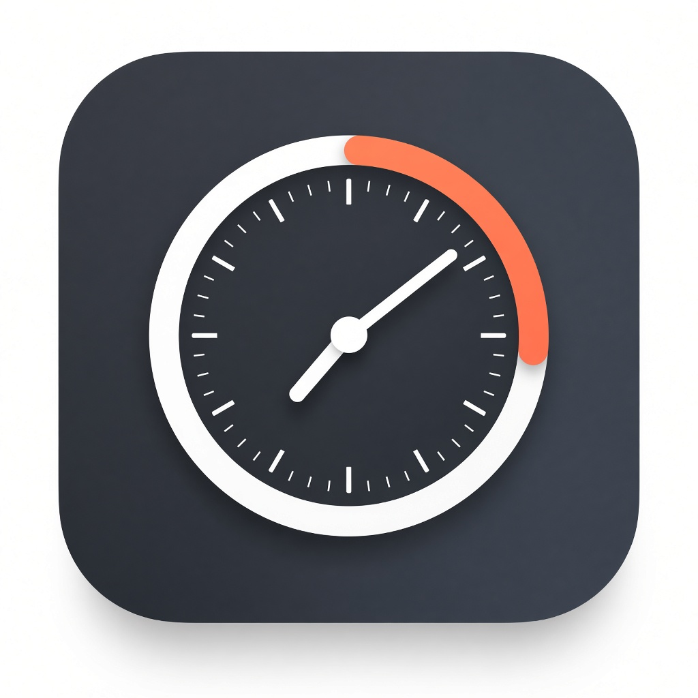

<p align="center">
  
</p>

<h1 align="center">DragTimer</h1>

<p align="center">
  <strong>Free macOS menu bar timer</strong> — drag to set, release to start.<br>
  A lightweight countdown timer for Mac that lives in your menu bar.
</p>

<p align="center">
  <a href="https://github.com/vipul-upforce/DragTimer/releases/latest"></a>
  <a href="https://github.com/vipul-upforce/DragTimer/releases"></a>
  
  
</p>

<p align="center">
  <a href="#download"><strong>Download for Mac</strong></a> ·
  <a href="#how-to-use">How to use</a> ·
  <a href="#features">Features</a> ·
  <a href="#build-from-source">Build from source</a>
</p>

---

## Why DragTimer?

Most Mac timers bury duration behind menus and number pads. **DragTimer** turns setting a timer into a gesture: grab the menu bar icon, drag, and let go. Instant countdown. No Dock clutter. Built for focus work, cooking, Pomodoro-style sessions, and quick reminders.

Inspired by the interaction idea behind Gestimer — this is an **original open-source implementation** (no Gestimer source, branding, or assets).

## Download

**[↓ Download DragTimer for macOS](https://github.com/vipul-upforce/DragTimer/releases/latest)**

1. Grab `DragTimer-*-macos.zip` from the [latest release](https://github.com/vipul-upforce/DragTimer/releases/latest).
2. Unzip and drag **DragTimer.app** into **Applications**.
3. Open it (right-click → **Open** the first time if macOS Gatekeeper warns — the build is ad-hoc signed, not Apple-notarized).
4. Look for the timer icon in the menu bar.

**Requirements:** macOS 13 Ventura or later.

## How to use

| Action | What happens |
|--------|----------------|
| **Drag** the menu bar icon | Duration grows with distance; a HUD follows the pointer |
| **Release** | Timer starts |
| **Click** the icon | See active timers, edit titles, open settings |
| **⌥ Option** while dragging | ~4× longer timers |
| **⇧ Shift** while dragging | Finer / precision control |
| **Right-click** | Quick presets + Quit |
| Quick buttons | **5m / 15m / 30m / 1h** from the popover |

When a timer finishes you can get a **menu popup** (works in Focus / Do Not Disturb), system notification, and/or sound — configurable in Settings.

## Features

- **Drag-to-set menu bar timer** for macOS
- Floating duration HUD while you drag
- Multiple timers at once; nearest countdown in the menu bar
- Editable titles, cancel, and snooze/reset
- macOS notifications + optional sound
- In-app completion popup that still works under Focus / DND
- Optional **Apple Reminders** sync
- Optional **Launch at Login**
- Timers persist across relaunches
- Menu-bar only — no Dock icon (`LSUIElement`)

## Build from source

```bash
brew install xcodegen   # once
./make-project.sh
open DragTimer.xcodeproj
```

Or produce a local `.app`:

```bash
./make-project.sh && ./build-app.sh
# → ./dist/DragTimer.app
```

For sharing outside your Mac, sign and notarize with an Apple Developer account when you can.

## Keywords

`macOS timer` · `menu bar timer` · `Mac countdown` · `drag timer` · `Pomodoro Mac` · `Gestimer alternative` · `menubar app` · `focus timer` · `Swift` · `AppKit`

## License

[MIT](LICENSE) — free to use, modify, and share.

---

<p align="center">
  Made for Mac · <a href="https://github.com/vipul-upforce/DragTimer">vipul-upforce/DragTimer</a>
</p>
